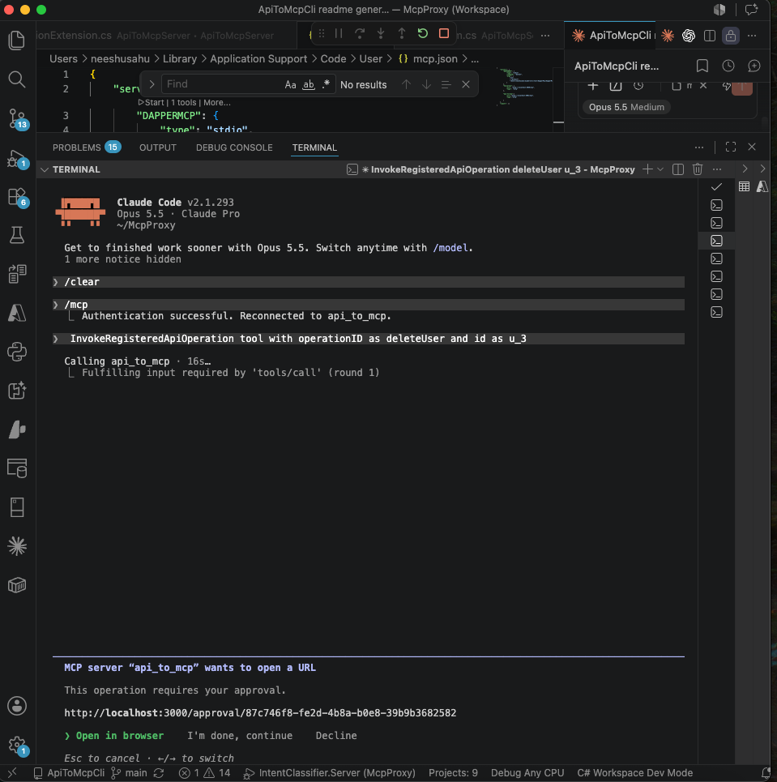
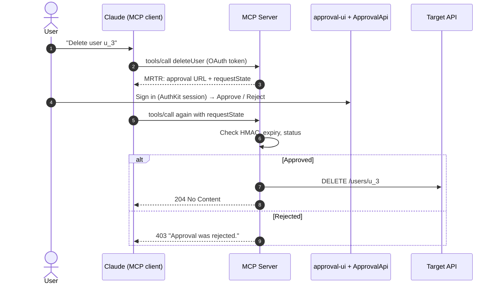
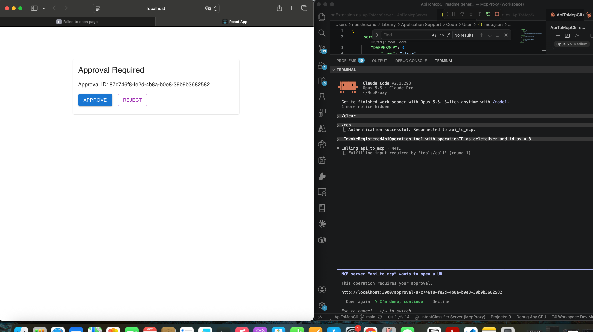
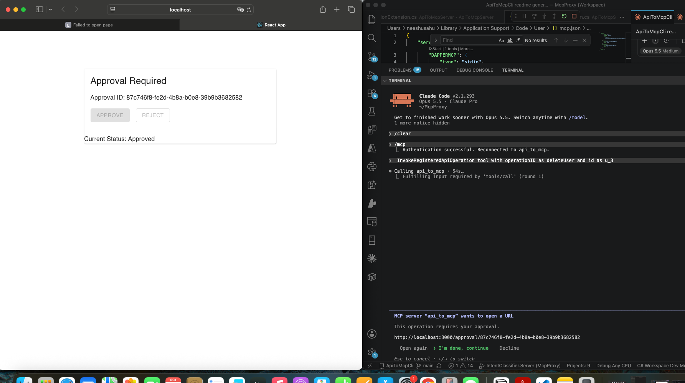
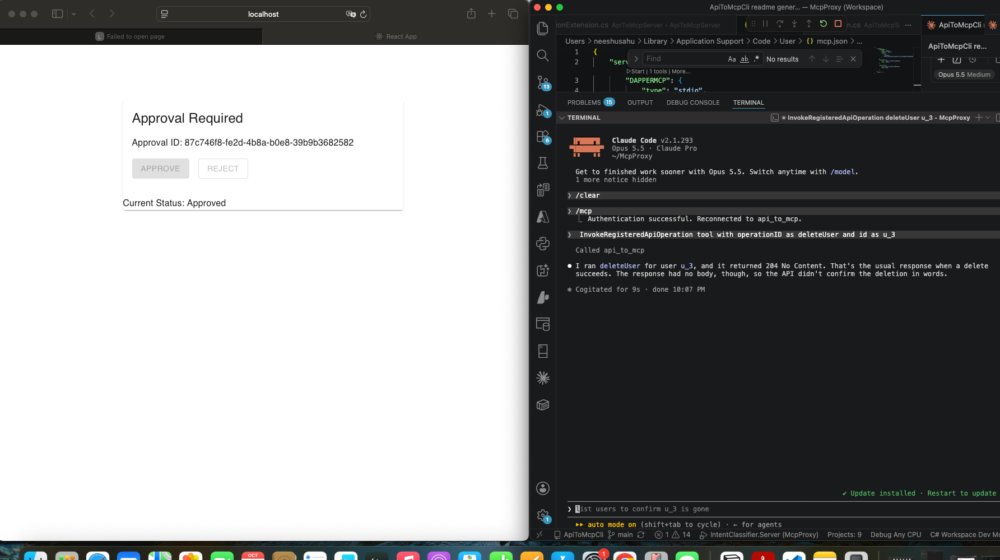
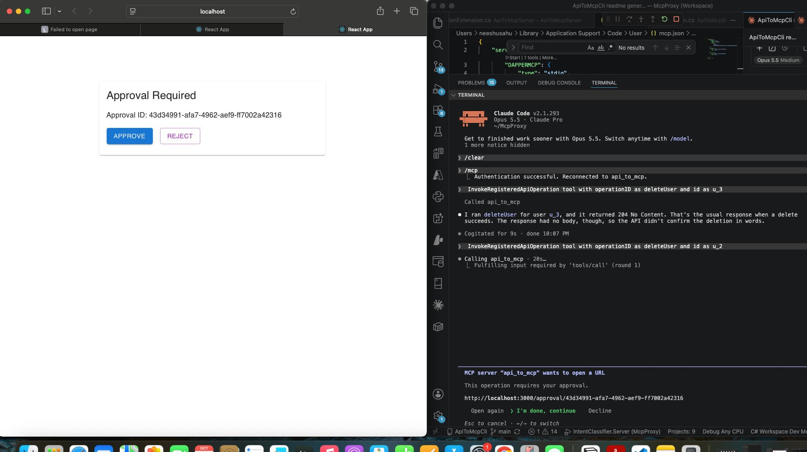
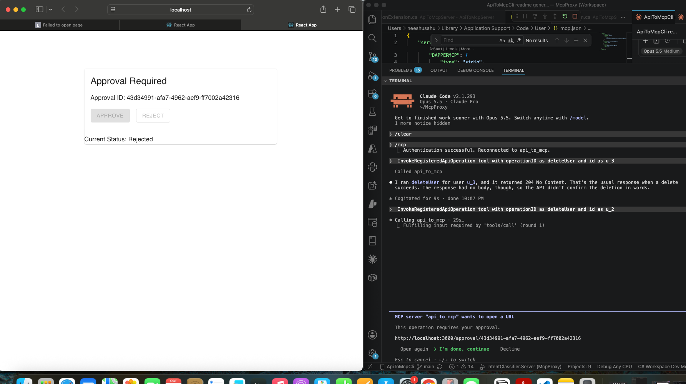
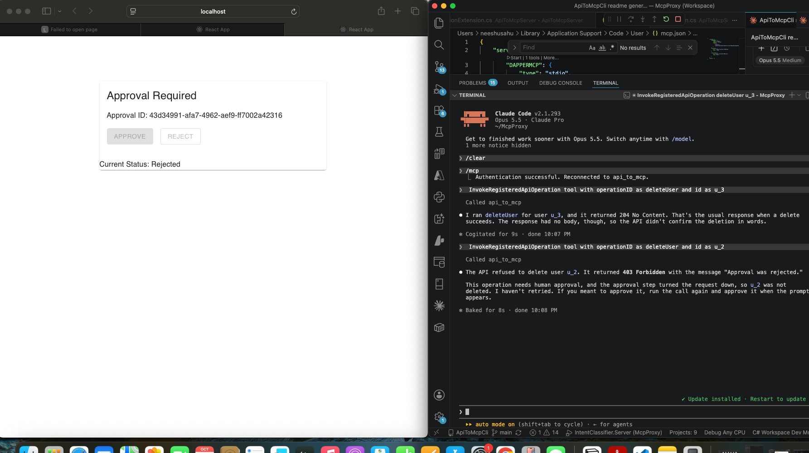
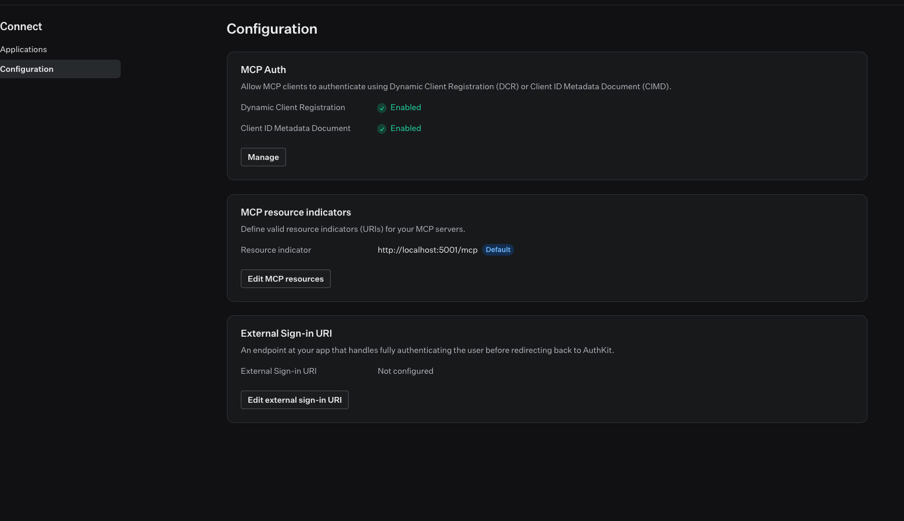

# ApiToMcpServer

Turn **any REST API** into tools for AI agents over **MCP**, where **risky actions such as deletes and updates only run after a person approves them**. Identity on both sides comes from **WorkOS AuthKit**.

> **Step 1 lives in a separate repo:** [ApiToMcpCli](https://github.com/neeshusahu/ApiToMcpCli) turns an OpenAPI spec into the `registry.json` this server runs on.



## Highlights

- **OpenAPI → MCP, no per-endpoint code.** [ApiToMcpCli](https://github.com/neeshusahu/ApiToMcpCli) generates `registry.json`, and one generic tool calls any operation in it.
- **Risk levels.** `GET` runs straight away. `POST`, `PUT` and `DELETE` wait for a person to approve.
- **Two AuthKit tokens.** The agent uses an **OAuth** token; the approver uses a **session** token. An agent can never approve its own action.
- **MRTR approvals.** The server stays stateless: it pauses the tool call, sends an approval link, and resumes when the client calls again.
- **Tamper-proof approvals.** An HMAC ties each approval to the exact arguments. Approvals expire after 10 minutes and can be decided only once.

## How it works



## Projects

| Project | Role |
|---|---|
| **[ApiToMcpCli](https://github.com/neeshusahu/ApiToMcpCli)** *(separate repo, step 1)* | Turns an OpenAPI spec into `registry.json`: operations, parameters, pagination and risk levels |
| [ApiToMcpServer](src/ApiToMcpServer) | MCP server: OAuth validation, the generic tool, MRTR approvals with HMAC ([README](src/ApiToMcpServer/README.md), [challenges](src/ApiToMcpServer/challenges.md)) |
| [ApprovalApi](src/ApiToMcpServer.ApprovalApi) | Records approve/reject decisions; accepts session tokens only ([README](src/ApiToMcpServer.ApprovalApi/README.md)) |
| [approval-ui](src/approval-ui) | React approval page using `@workos-inc/authkit-react` ([README](src/approval-ui/README.md)) |
| [Persistence](src/ApiToMcpServer.Persistence) | Dapper + SQLite: users and approvals ([README](src/ApiToMcpServer.Persistence/README.md)) |
| [SampleApi](src/ApiToMcpServer.SampleApi) | In-memory User Management API the agent calls |
| [Tests](src/ApiToMcpServer.Tests) | NUnit + Moq, 44 tests |

## Two AuthKit tokens

| | Agent: **OAuth token** | Approver: **session token** |
|---|---|---|
| Obtained via | OAuth 2.1 + PKCE (Dynamic Client Registration or Client ID Metadata Document) | `AuthKitProvider` → `getAccessToken()` |
| Issuer | `https://<subdomain>.authkit.app` | `https://api.workos.com/user_management/<clientId>` |
| Audience | `http://localhost:5001/mcp` | — |
| Accepted by | MCP server only | ApprovalApi only |

Both tokens carry the same WorkOS user ID (`sub`), so the requester and the approver are stored in the same `Users` table.

The MCP client finds AuthKit on its own. The server's `401` response points it to `/.well-known/oauth-protected-resource`, which names the AuthKit domain as the authorization server.

## Why MRTR

`ElicitAsync` failed with *"Elicitation is not supported in stateless mode"*. **MRTR (Multi Round-Trip Requests)** does the same job without a server session:

1. The tool stores a Pending approval and throws an `InputRequiredException` containing the approval URL, with `requestState = approvalId`.
2. The user approves or rejects in the browser, then tells Claude to continue.
3. Claude calls the tool again with that `requestState`. The server checks the HMAC, expiry and status, then runs the call or refuses it.

## Walkthrough

**Approved:** the delete runs.

| 1. Pending | 2. Approved | 3. Result: `204` |
|---|---|---|
|  |  |  |

**Rejected:** the delete is refused.

| 1. Pending | 2. Rejected | 3. Result: `403` |
|---|---|---|
|  |  |  |

## WorkOS configuration

1. **Connect → Configuration:**
   - enable **Dynamic Client Registration** and **Client ID Metadata Document**
   - add the resource indicator `http://localhost:5001/mcp` and mark it **Default**

   

2. **Authentication → Features → JWT template:** add the claims the server reads. Sign in again with `/mcp` after changing it.
   ```json
   { "email": {{ user.email }}, "first_name": {{ user.first_name }}, "last_name": {{ user.last_name }} }
   ```

3. **For approval-ui:**
   - add the redirect URI `http://localhost:3000`
   - allow the CORS origin `http://localhost:3000`
   - put the client ID in `src/approval-ui/.env`

## Getting started

### 1. Generate the registry with ApiToMcpCli

Start with **[ApiToMcpCli](https://github.com/neeshusahu/ApiToMcpCli)**. It reads your API's OpenAPI spec and produces the `registry.json` that this server loads:

```bash
git clone https://github.com/neeshusahu/ApiToMcpCli.git
cd ApiToMcpCli/src/ApiToMcpCli
dotnet run -- generate openapi.yaml -o registry.json
cp registry.json <this-repo>/src/ApiToMcpServer/registry.json
```

This repo already includes a `registry.json` generated from the sample User Management spec. Skip this step if you're running the demo as it is.

### 2. Set the secrets

The committed config only has placeholders:

```bash
cd src/ApiToMcpServer
dotnet user-secrets set "Jwt:Issuer" "https://<subdomain>.authkit.app"
dotnet user-secrets set "Approval:HashKey" "$(openssl rand -base64 32)"

cd ../ApiToMcpServer.ApprovalApi
dotnet user-secrets set "WorkOS:ClientId" "client_..."
dotnet user-secrets set "WorkOS:Issuer" "https://api.workos.com/user_management/client_..."
dotnet user-secrets set "WorkOS:ApiKey" "sk_test_..."

cd ../approval-ui && cp .env.example .env    # set REACT_APP_WORKOS_CLIENT_ID
```

### 3. Run

Run each in its own terminal, from the repository root:

```bash
dotnet run --project src/ApiToMcpServer.SampleApi                         # :5080
dotnet run --project src/ApiToMcpServer --launch-profile http             # :5001
dotnet run --project src/ApiToMcpServer.ApprovalApi --launch-profile http # :5282
cd src/approval-ui && npm install && npm start                            # :3000
```

### 4. Connect Claude

Point Claude Code at `http://localhost:5001/mcp` (`"type": "http"` in `.mcp.json`), run `/mcp` to sign in, then try *"Delete user u_3"*.

Run the tests with `dotnet test`.

## Next steps

- Require the approver to be a different person from the requester, and add an approver role (WorkOS RBAC)
- Show the operation details on the approval page
- An audit trail view
