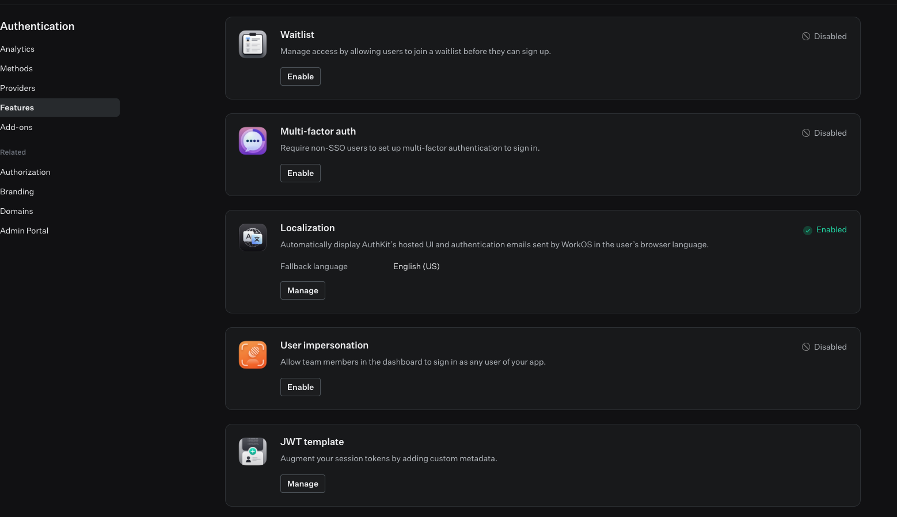

# ApiToMcpServer

A generic **MCP server** that exposes any REST API to AI agents. It reads a `registry.json` generated by [ApiToMcpCli](../../ApiToMcpCli) and serves a single tool that can call any operation in that registry.

- **Authentication:** WorkOS AuthKit acts as the OAuth 2.1 authorization server.
- **Approval:** operations marked `write` or `destructive` pause until a person approves them in **approval-ui**.

```
Claude (MCP client) ──OAuth──► WorkOS AuthKit
        │ Bearer token
        ▼
ApiToMcpServer (:5001/mcp) ──► read: call the API immediately
        │ write / destructive
        ▼
Pending approval (SQLite) ──► approval-ui / ApprovalApi ──► Approved / Rejected
        │ client retries
        ▼
Status checked ──► call the API (:5080), or deny
```

---

## 1. Configure WorkOS for MCP authorization

In the [WorkOS Dashboard](https://dashboard.workos.com), select your environment and go to **Connect → Configuration**.


| Card | Setting | Value |
|---|---|---|
| **MCP Auth** (click **Manage**) | Dynamic Client Registration | **Enabled** |
| | Client ID Metadata Document | **Enabled** |
| **MCP resource indicators** (click **Edit MCP resources**) | Resource indicator | `http://localhost:5001/mcp`, marked **Default** |
| **External Sign-in URI** | — | Not needed; leave it **Not configured** |

1. **Dynamic Client Registration (DCR):** MCP clients such as Claude Code register themselves with AuthKit automatically, so you don't have to create a client for each one.
2. **Client ID Metadata Document (CIMD):** clients that publish their metadata at a URL can use that URL as their client ID, with no registration step.
3. **Resource indicator:** your MCP server's URL. AuthKit puts it in the access token's `aud` (audience) claim. It must **exactly match** `Jwt:Audience` in `appsettings.json`, including the scheme, port and path, with no trailing slash. Because it's marked **Default**, clients that don't ask for a specific resource still get a token for this server.

Then copy your **AuthKit domain**, for example `https://<your-subdomain>.authkit.app`. This is the token issuer.

---

## 2. JWT validation configuration

`appsettings.json`:

```json
{
  "Jwt": {
    "Issuer": "https://<your-subdomain>.authkit.app",
    "Audience": "http://localhost:5001/mcp"
  },
  "ApiRegistry": {
    "Path": "registry.json"
  },
  "ConnectionStrings": {
    "ApprovalDb": "Data Source=../../ApprovalDb.sqlite"
  }
}
```

Keep the HMAC key used for approvals in user secrets, not in the file:

```bash
dotnet user-secrets set "Approval:HashKey" "$(openssl rand -base64 32)"
dotnet user-secrets set "Jwt:Issuer" "https://<your-subdomain>.authkit.app"
```

The JwtBearer setup in `Program.cs`:

```csharp
.AddJwtBearer(options =>
{
    options.Authority = issuer;        // discovers AuthKit's signing keys via OIDC metadata
    options.Audience = resource;
    options.MapInboundClaims = false;  // keep "sub", "email" etc. as-is

    options.TokenValidationParameters = new TokenValidationParameters
    {
        ValidateIssuer = true,          ValidIssuer = issuer,
        ValidateAudience = true,        ValidAudience = resource,
        ValidateLifetime = true,
        ValidateIssuerSigningKey = true,
        ValidAlgorithms = new[] { SecurityAlgorithms.RsaSha256 }
    };
});
```

| Check | Why |
|---|---|
| **Issuer** | The token was issued by your AuthKit domain |
| **Audience** | The token was issued **for this MCP server** (the resource indicator), not for some other API |
| **Signature** | Signed with AuthKit's RS256 keys, which are discovered automatically through `Authority` |
| **Lifetime** | Not expired |

---

## 3. Protected resource metadata endpoint

An MCP client first needs to find out **which authorization server protects this server**. The server publishes that information at a well-known URL ([RFC 9728](https://datatracker.ietf.org/doc/html/rfc9728)):

```csharp
app.MapGet("/.well-known/oauth-protected-resource", () =>
    Results.Json(new
    {
        resource,                                  // http://localhost:5001/mcp
        authorization_servers = new[] { issuer },  // https://<your-subdomain>.authkit.app
        bearer_methods_supported = new[] { "header" }
    }));
```

When a request has no valid token, the server's `401` response points the client to this endpoint:

```csharp
OnChallenge = context =>
{
    context.Response.Headers["WWW-Authenticate"] =
        "Bearer error=\"unauthorized\", " +
        "resource_metadata=\"http://localhost:5001/.well-known/oauth-protected-resource\"";
    return Task.CompletedTask;
}
```

The full sign-in flow:

```
1. Client  → POST /mcp (no token)
2. Server  → 401 + WWW-Authenticate: resource_metadata="…/oauth-protected-resource"
3. Client  → GET /.well-known/oauth-protected-resource → learns the AuthKit issuer
4. Client  → registers with AuthKit (DCR or CIMD), user signs in, gets a token for resource=…/mcp
5. Client  → POST /mcp with Authorization: Bearer <token> → validated → tool call runs
```

This endpoint is public discovery information. It doesn't authenticate anyone; the JwtBearer middleware does that.

---

## 4. JWT template

By default, AuthKit access tokens carry `sub`, `iss`, `aud`, `exp` and similar claims, but **no profile fields**. The server needs the user's email and name to create the user row that approvals refer to. `WorkOSUserInfoClient` reads them directly from the token:

```csharp
var email     = principal.FindFirst("email")?.Value;
var firstName = principal.FindFirst("first_name")?.Value;
var lastName  = principal.FindFirst("last_name")?.Value;
```

Add them with a **JWT template** in the WorkOS Dashboard.

### Configure the template

1. Open the [WorkOS Dashboard](https://dashboard.workos.com) and select the **same environment** as your AuthKit domain, for example Staging.
2. Go to **Authentication → Features**, find the **JWT template** card ("Augment your session tokens by adding custom metadata") and click **Manage**.

   
3. Add the profile claims:
   ```json
   {
     "email": {{ user.email }},
     "first_name": {{ user.first_name }},
     "last_name": {{ user.last_name }}
   }
   ```
4. Save the template.

### Apply and check a change

The template applies only to **newly issued** tokens. Tokens that already exist keep their old claims until they expire. After saving a change:

1. **Get a new token.** In Claude Code, run `/mcp`, select `api_to_mcp` and re-authenticate. Restarting the MCP server is **not** needed, because claims come from the token, not from server configuration.
2. **Check the token.** Decode it at [jwt.io](https://jwt.io) and confirm that `email`, `first_name` and `last_name` are present, and that `aud` is still `http://localhost:5001/mcp`.
3. **Check the server.** Make a tool call. If a claim is missing, `EnsureUserExistsAsync` fails with *"One or more required user information fields are null or empty"*.

### Rules for editing

- **Keep the claim names in sync with the code.** If you rename a claim in the template, update `WorkOSUserInfoClient` at the same time, or the server will reject every user.
- **Don't try to override reserved claims** such as `sub`, `iss`, `aud`, `exp` or `sid`. WorkOS controls them, and JWT validation depends on them.
- **Add only what the server needs.** Anything in the template ends up in every access token, which is readable by anyone holding it. Keep sensitive data out.
- **Users without a value.** If a user has no first or last name in WorkOS, the claim will be empty and the server will reject that user. Make sure test users have complete profiles.

---

## 5. Two kinds of WorkOS token: MCP OAuth vs approval session

WorkOS issues the tokens for **both** halves of the system, but they are **different kinds of token**:
- The **MCP client** (the agent) gets an **OAuth access token**, acting for the user.
- The **person approving** in approval-ui gets an **AuthKit session access token** for signing in to that app.

| | **MCP OAuth token** (this server) | **AuthKit session token** (approval-ui → ApprovalApi) |
|---|---|---|
| Purpose | A third-party client (Claude) acts **on behalf of** a user | A person signs in to **our own** web app |
| How it's obtained | OAuth 2.1 authorization code + PKCE, after Dynamic Client Registration or a Client ID Metadata Document | `AuthKitProvider` / `signIn()` / `getAccessToken()` in React |
| Issuer (`iss`) | `https://<your-subdomain>.authkit.app` | `https://api.workos.com/user_management/<clientId>` |
| Audience (`aud`) | The resource indicator: `http://localhost:5001/mcp` | None |
| Validated by | This server: issuer + **audience** + signature + lifetime | ApprovalApi: issuer (includes the client ID) + signature + lifetime |
| Signing keys | Discovered from `Authority` (OIDC metadata) | `https://api.workos.com/sso/jwks/<clientId>` |
| Refreshed by | The MCP client, through the OAuth token endpoint | The AuthKit SDK, using a refresh token |
| Can it approve? | **No.** ApprovalApi rejects it because the issuer is wrong. | **Yes**, this is the only token ApprovalApi accepts |

### Why two tokens

That separation is the core security property: **an agent can never approve its own action.**
- The agent's OAuth token works only on the MCP server, which rejects any token not issued for `aud = …/mcp`.
- ApprovalApi accepts only session tokens from approval-ui, so it rejects the agent's OAuth token.

Approving therefore needs a real person, signed in to approval-ui in a browser.

Both tokens identify the same WorkOS user through **`sub`**. Both services store users by that ID, so the requester (`Approvals.CreatedBy`) and the approver (`Approvals.UpdatedBy`) are rows in the same `Users` table. That makes rules such as "the approver must be a different person from the requester" straightforward to enforce.

---

## 6. Require authorization on the MCP endpoint

```csharp
app.UseAuthentication();
app.UseAuthorization();

app.MapMcp("/mcp").RequireAuthorization();
```

Without `.RequireAuthorization()`, unauthenticated requests would reach the tool, and the `401` that starts the OAuth flow would never be sent. The tool also checks the `sub` claim itself before it does anything.

---

## 7. Human approval: from `ElicitAsync` to MRTR

### The problem

The first version asked the client to open the approval page during the tool call:

```csharp
await mcpServer.ElicitAsync(new ElicitRequestParams { Mode = "url", Url = approvalUrl, ... });
```

That threw **`Elicitation is not supported in stateless mode`**. Elicitation is a request from the server to the client in the middle of a call, which needs a stateful HTTP session. This server runs **stateless**:

```csharp
builder.Services.AddMcpServer()
    .WithHttpTransport(o => o.Stateless = true)
    .WithToolsFromAssembly();
```

### The solution: MRTR (Multi Round-Trip Requests)

Rather than holding a session open, the server **ends the tool call** and tells the client what input it needs. The client gathers that input and **calls the tool again**, sending back state the server gave it. Each request stands on its own, so the server stays stateless.

```csharp
if (!approval.IsMrtrSupported)
    return Forbidden($"Approval required. Open http://localhost:3000/approval/{approvalId} to approve, then retry.");

throw ApprovalRequired(approvalId);   // InputRequiredException: URL elicitation + requestState
```

`ApprovalRequired` throws an `InputRequiredException` that includes:
- a **URL elicitation** pointing at `http://localhost:3000/approval/{approvalId}`
- the **`requestState`**, set to the approval ID. The client must send this back unchanged when it retries.

**Clients without MRTR support** get a `403` message with the approval link. The user approves the request, then asks the agent to retry.

---

## 8. Detecting retries and protecting the operation

### The tool's request context

The tool receives the MCP call parameters through `RequestContext<CallToolRequestParams>`. From them it builds an `ApprovalContext`:

```csharp
var approvalContext = new ApprovalContext(
    context.Server.IsMrtrSupported,     // can this client do MRTR?
    context.Params?.RequestState,       // null on the first call; the approval ID on a retry
    context.Params?.InputResponses);    // what the client collected (the elicitation result)
```

**A call is a retry if `RequestState` holds a valid approval ID.** On a first call it's `null`.

### Hashing the operation (HMAC)

Approval status alone isn't enough. Without a further check, a retry could reuse an approved ID with **different arguments**, for example approve deleting `u_3` and then retry with `u_1`. So when the approval is created, the server stores an **HMAC-SHA256** of the call:

```csharp
var canonical = new { Id = approvalId, OperationId = operation.Name, Fields = fields, PathParams = pathParams };
using var hmac = new HMACSHA256(Encoding.UTF8.GetBytes(configuration["Approval:HashKey"]!));
var hash = Convert.ToBase64String(hmac.ComputeHash(Encoding.UTF8.GetBytes(JsonSerializer.Serialize(canonical))));
```

- The hash covers the **approval ID, operation ID, body fields and path parameters**.
- It's keyed with a server-side secret, so it can't be forged without that key.
- Only the hash is stored in `Approvals.Operation`. The arguments themselves aren't stored.

### What happens on each call

```
First call (RequestState == null)
  ├─ risk = read                 → call the API immediately
  └─ risk = write / destructive  → store approval { Pending, HMAC, CreatedBy, ExpiresAt = now + 10 min }
                                   → MRTR: InputRequiredException(url, requestState = approvalId)
                                   → no MRTR: 403 with approval link

Retry (RequestState = approvalId)
  ├─ not a valid GUID           → error "Invalid approval state"
  ├─ approval not found         → error "Approval not found"
  ├─ recomputed HMAC ≠ stored   → error "Request arguments changed after approval was requested"
  │                               (constant-time comparison)
  ├─ ExpiresAt < now            → 403 "Approval expired. Call the tool again…"
  └─ status
       ├─ Approved  → call the API
       ├─ Pending   → ask again (same requestState)
       └─ Rejected  → 403 "Approval was rejected."
```

The HMAC proves the arguments haven't changed. The status proves a person approved. A call runs only when both checks pass, and the approval hasn't expired.

---

## Run

```bash
# from the solution folder
dotnet run --project src/ApiToMcpServer.SampleApi                       # target API on :5080
dotnet run --project src/ApiToMcpServer --launch-profile http          # MCP server on :5001
```

Point the MCP client at it, for example in Claude Code's `.mcp.json`:

```json
{
  "mcpServers": {
    "api_to_mcp": { "type": "http", "url": "http://localhost:5001/mcp" }
  }
}
```

Start the server **before** the client, then authenticate with `/mcp`.
